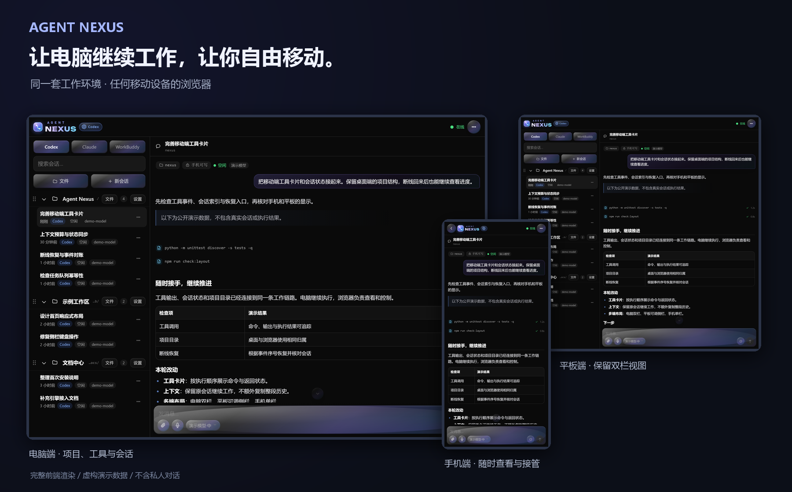

# Agent Nexus

<p align="center">
  
</p>

<p align="center">
  <a href="LICENSE"></a>
  
  <a href="docs/INSTALLATION.md"></a>
  <a href="docs/images/README.md"></a>
  
  <a href="https://github.com/Sulanya/Agent-Nexus/stargazers"></a>
</p>

<p align="center">
  <a href="docs/ARCHITECTURE.md#agent-能力与边界"></a>
  <a href="docs/ARCHITECTURE.md#agent-能力与边界"></a>
  <a href="docs/ARCHITECTURE.md"></a>
  <a href="docs/ARCHITECTURE.md"></a>
  <a href="docs/API.md"></a>
</p>

**通过任何移动设备的浏览器，查看和接管电脑上的 AI 编程会话，保留现有工作环境。**

[English](README.en.md) · [安装与使用](docs/INSTALLATION.md) · [本机 AI 安装/读档提示词](docs/LOCAL_AGENT_SETUP_PROMPT.md) · [项目说明](docs/PROJECT.md) · [架构](docs/ARCHITECTURE.md) · [安全边界](SECURITY.md)

Agent Nexus（AN）是本机 AI 编程会话的远程工作台，即你的个人PC继续承担项目文件、工具、Agent 执行和原有登录环境；手机、平板以及其他能够运行现代浏览器的移动设备用来查看进度、发送指令与管理会话。移动浏览器需要支持 JavaScript、WebSocket 和响应式页面；不保证兼容所有设备及旧浏览器。

AN 是楚齐同学把自己日常使用的本机 AI 编程工作流整理成的开源项目：希望尽量沿用电脑上已经登录的 Agent、已有项目和原有的历史会话，让移动设备成为查看与接管入口。当前开源源码是通用版本；它不带我的个人账号、工作档案或私人配置。任何第三方下载者可以把[这段提示词](docs/LOCAL_AGENT_SETUP_PROMPT.md)交给自己电脑上已登录的编程 Agent，让它按步骤把 AN 配到本机，并接入使用者自己的历史会话档案。

AN 复用和迁移你自己安装和配置的 Agent，它不是独立的模型服务，也不附送模型订阅、API 额度或第三方账号。**本仓库没有内置作者的 API key、provider 密钥或访问 token。**源码包含读取使用者本机 provider 配置的适配代码，但不包含作者凭据；网关会在使用者自己的电脑上生成本地访问 token。不要把密钥粘贴到 README、GitHub、Issue 或提示词里。

## 重要！！！AN可以做什么？

- 在浏览器继承电脑端，接管会话、流式增量输出、工具执行与运行状态。
- 接入 Codex、本地 Claude Code，以及 WorkBuddy 兼容会话，（各位同学也可以基于本项目继续增加对DSH、Trae、Kimi以及其他任何你喜欢框架！）
- 管理本机电脑端项目分组、文件与会话，调整桌面侧栏宽度，在移动设备上使用单栏界面。
- 通过优化后的进程持久提交收据、稳定请求 ID、队列和事件恢复降低重复执行与断线丢状态风险。
- 创建一次性定时任务，以及只发送明确任务说明的跨会话交接。
- 使用完整权限和只读权限的不同连接方式，确保多平台同步接管的状态幂等。
- 关于命名，Nuxus的拉丁语本意为：捆绑、系在一起、链接、纽带、关联，我想没有任何一个词更能精准表达AN的用意！
- 关于设计，楚齐同学坚信好的设计和产品一定是具有审美的，因此我引入和借鉴了很多美学元素作为设计旋律，如果你在本项目品尝到了苹果生态的液体玻璃的味道，请不要惊慌。毕竟，，
- 好的设计总是心有灵犀（乐）！

[](docs/images/overview.png)

更多界面截图请查看 **[电脑 / 平板 / 手机演示图](docs/images/README.md)**，图片集中放在 `docs/images/`。

## 为什么要做 AN？

这个项目的发起是因为楚齐同学自己在电脑上用 AI 写代码，却经常需要离开电脑，发现“远程使用本机 Agent”这件事并不自由，甚至很难受，

当前的现实是：Codex 可以远程，但其远程能力主要依赖账号体系，不能把电脑上的本地工作环境通过一个自建 API 暴露出来；WorkBuddy以及包括 DeepSeek Harness 在内的一些类似工具，也往往要求登录各自的账号或服务。电脑上的项目、会话、模型权限和远程入口被分散在不同的账号体系里。

所以这便是做了 Agent Nexus的初衷，即先让电脑作为主机继续负责真正的工作，再让任何移动设备的浏览器成为查看和接管入口，尽量摆脱第三方的账号体系！

更长远的目标，是尽可能摆脱“必须依赖某个平台账号才能远程控制自己电脑”的限制，让个人拥有自己的工作环境、自己的会话档案和自己的连接方式，尤其是在多个不同设备之间，甚至可以设置设备ID来在不同设备同步记忆文件。

楚齐同学的看法很简单：**共产主义社会不应该存在这些不必要的限制（狗头）。** 工具应该服务于人，而不是把人锁在某个账号、某个客户端或某个远程套餐里。
因此决定开源 AN，就是把这条路交给更多人一起验证、修改和继续建设。

当然，源码预览版还没有魔法般消除所有账号依赖：Codex、WorkBuddy、Claude Code 和 DeepSeek Harness 等外部 Agent 的本地登录、服务条款和模型权限仍由各自平台决定。AN 当前能做的是不再额外建立一套 AN 云账号，把远程控制放在用户自己的电脑上，并尽可能直接读取用户已经拥有的本地会话和项目。未来能否完全摆脱某个外部账号，取决于对应 Agent 是否提供本地协议、API 或可替代的执行入口。

此外，AN在开发过程初期，想测试对反-反编译的防备，不过效果不好，后来废弃了！不过代码的部分还是留了一部分，设置了本机的登录凭证，后续使用过程可以把这一部分注释掉，不用认证！

## 先了解支持边界

这是 **源码预览版**。Windows 是已有实测最多的平台；MacOS 脚本在仓库中，Linux 网关可开发验证，但没有声称已经通过全平台交付验收。

| 功能 | Codex | Claude Code | WorkBuddy |
|---|---|---|---|
| 历史/流式会话 | 已实现，依赖本机 app-server/rollout 格式 | 已实现，依赖本地 CLI/JSONL | 已实现适配，依赖本机桌面索引和 CLI 格式 |
| 项目归属 | 对接原生项目数据和回读 | 以目录组织，区别于 Codex 原生项目 | 以原生索引与工作目录组织 |
| 未发送的新会话 | 使用原生创建流程 | AN 草稿，首条消息后原生落盘 | AN 草稿，首条消息后原生落盘 |
| 桌面控制权 | 接管/交还需与原生锁协调 | 引擎行为不同 | 引擎行为不同 |

**尚不承诺三个引擎的所有功能、所有客户端的实时状态完全一致。** 空标题不是删除依据；内部子智能体日志不会作为独立用户聊天展示。模型和第三方引擎更新可能改变协议，需要相应回归。

## 快速开始

需要 Python 3.11、已安装并登录的 Codex；Claude Code / WorkBuddy 为按需接入。第一次先在本机访问，确认正常后再配置远程网络。

```powershell
# Windows：在源码目录运行
python -m venv .venv
.\.venv\Scripts\python.exe -m pip install -r requirements.txt
Copy-Item an.config.example.json an.config.json
.\.venv\Scripts\python.exe tools/dev.py start
.\.venv\Scripts\python.exe tools/dev.py open
```

```bash
# macOS / Linux：源码开发入口
python3.11 -m venv .venv
.venv/bin/python -m pip install -r requirements.txt
cp an.config.example.json an.config.json
.venv/bin/python tools/dev.py start
.venv/bin/python tools/dev.py open
```

`open` 在本机浏览器打开私人连接，不在终端输出 token。`status` 查询状态；`stop` 只终止通过健康 PID 和源码路径核对的本实例，不清理聊天。源码启动器默认仅监听 `127.0.0.1:8790`，不会自动开公网隧道。

## 让本机 AI 帮你安装并接入自己的档案

下载源码并解压后，可以把下面提示词发给**你自己电脑上已经安装的 Codex、Claude Code 或其他编程 Agent**。先确认它运行在源码目录，检查实际平台、Agent 和本地路径，再让它分步执行。不要把 API key、访问链接、整份聊天记录或配置密钥粘贴给 AI；需要凭据时应由本机 Agent 通过已有登录状态读取。

```text
你好，我是这台电脑的使用者。请帮我安装和配置 Agent Nexus，并连接我自己的本机 AI 编程会话档案。

先读取当前目录 README.md、docs/INSTALLATION.md、docs/LOCAL_AGENT_SETUP_PROMPT.md 和 SECURITY.md。然后检查我的操作系统、Python 3.11、已经安装的 Codex/Claude Code/WorkBuddy，以及它们各自实际使用的数据目录。不要猜路径；先只读检查，并告诉我你准备访问哪些目录、为什么需要访问。

请使用本机已有 Agent 登录和 provider 配置，不创建或索取新的 API key；不要读取、输出或记录密钥值。不要把我的访问 token、私人链接、会话正文或个人路径写进仓库、日志、截图或 Git。不要读取其他用户目录。发现聊天数据库或 JSONL 时，先只读识别格式、归属和元数据；不得上传、复制进本仓库、移动、删除、改名或批量转换我的档案。

确认平台与路径后，在源码目录创建隔离虚拟环境、安装项目依赖、从 an.config.example.json 创建仅本机的 an.config.json。默认绑定 127.0.0.1、关闭公网隧道和额外执行权限。先启动本机实例并检查健康状态、认证和会话列表；不要连接公网，也不要重启、停止或修改另一份正在运行的 AN。

请先用只读方式把我本机现有 Codex/Claude Code/WorkBuddy 会话索引接入 AN，让我能在 AN 中查找自己的项目、历史对话标题、时间和状态。读取范围仅限我确认的 Agent 数据目录。检查 AN 是否能读取历史档案，但不得将全文复制或汇总进 README、仓库文档、Issue 或新的长期记忆。若我之后要求整理档案摘要，先建议输出到仓库外的本地私密目录，并等待我确认后再写。

完成后说明：实际读取的目录、识别到的 Agent、会话/项目计数、尚未支持的功能，以及本机访问方式。不得输出凭据或对话正文。若某个 Agent 需要额外配置或权限，先停下并解释原因，不要自行扩大访问范围。
```

这段提示词用于指导使用者自己的本机 AI，不会被 AN 自动发送，也不会授予对本机档案的额外权限。AN 能读取哪些历史索引取决于本机 Agent 格式、登录环境和文件权限；不能假设下载源码后就能自动解析所有会话全文。

配置文件和 `.env.example` 分别见[安装文档](docs/INSTALLATION.md)。`.env.example` 只展示变量，程序不自动加载 `.env`。

## 从移动设备连接

移动设备必须能访问运行 AN 的电脑。可使用可信局域网、自己的 VPN 或带 HTTPS 的隧道；远程网络方案由你部署。临时隧道域名可能在重建后变化。

1. 先验证本机的 `tools/dev.py status` 正常。
2. 局域网使用时显式配置监听地址；公网建议仍监听 loopback，并由安全的隧道/反向代理转发。
3. 执行 `tools/dev.py connect --base-url https://your-an-host.example`，把私人连接页留在本地，用其中二维码连接移动设备。
4. 私人链接和二维码等同于访问凭据，请勿放到 Issue、演示视频或 GitHub。用只读连接进行观察演示。
5. API配置这里容易出错，建议做好提示词工程。

## 开发与测试

```bash
python -m unittest discover -s gateway -v
node gateway/test_rpc_ui.cjs
python tools/audit_source.py
```

Windows 上可额外执行 `node gateway/test_workflow_ui.cjs`（需要 Edge），测试定时/交接和侧栏 UI。它使用隔离的模拟 API，不调用模型。不要让测试读写个人正式聊天库。

目录包括 `gateway/` 完整 Python 网关源码与测试、`ui/` 浏览器界面、`launcher/` 桌面启动器源码、`tools/` 源码启动/审计及既有平台包装脚本。运行时、第三方 CLI、模型文件和打包产物不在源码包中。

## 贡献与许可

贡献前阅读 [CONTRIBUTING.md](CONTRIBUTING.md)、[第三方说明](THIRD_PARTY_NOTICES.md) 和 [开源整理记录](docs/RELEASE_PREPARATION.md)。MIT 许可证见 [LICENSE](LICENSE)。第三方名称用于描述兼容性；本项目不代表相关厂商，也不保证第三方条款下所有使用方式都被允许。
