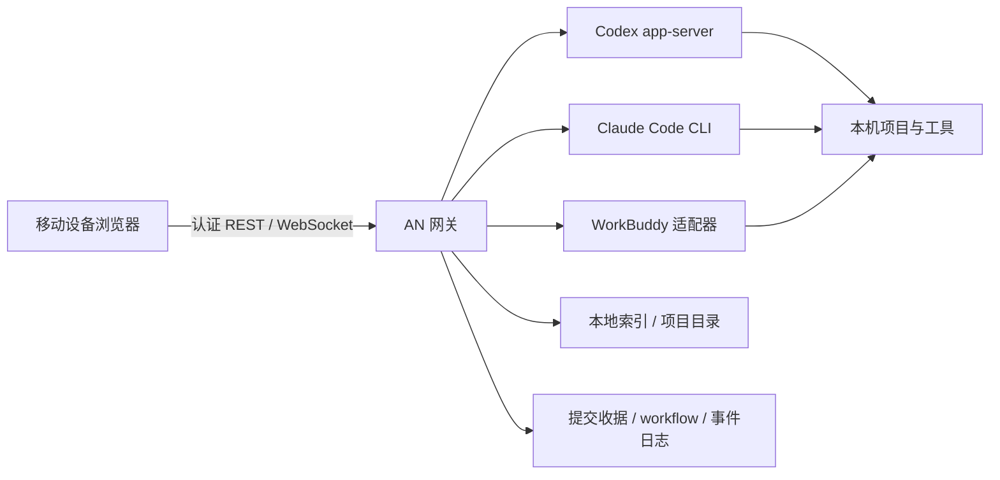

# 架构与可靠性

## 模块

| 模块 | 职责 |
|---|---|
| gateway/remote_server.py | HTTP/WS、鉴权、引擎接入与运行编排 |
| gateway/desktop_projects.py | Codex 项目目录、迁移兼容、归属投影 |
| gateway/desktop_project_commands.py | 原生项目变更与持久回读 |
| gateway/indexer.py | 会话索引快照，减少请求线程 IO |
| gateway/submission_ledger.py | 稳定请求 ID、收据、未知结果对账 |
| gateway/workflow_tasks.py | 一次性任务、同事务意图/命令收据/状态事件、租约 |
| gateway/workflow_runtime.py | workflow 到现有引擎提交路径的连接 |
| gateway/event_journal.py、recovery_projection.py | 有界事件持久化与断线恢复 |
| gateway/rpc_contract.py | 契约描述、独立协议版本与逐消息授权 |
| gateway/thread_visibility.py | 用户聊天与内部子线程可见性边界 |
| ui/index.html | 浏览器交互、流式合并、移动布局、侧栏调宽 |
| launcher/ | 可选桌面控制面板与图标生成源码 |

## 关键约束

ACK 只表示接收，不等于模型已开始或完成。结果未知必须按原 CID 查队列/事件，不换 ID 自动重发。设置与项目变更要读取持久状态确认。workflow 的 scheduled 行承担待执行 outbox，执行本身在数据库事务之外；崩溃恢复依赖稳定 CID 对账。

事件恢复是有界的。超过保留窗口时回退到持久会话投影，不能保证无限历史增量重放。当前实现仍包含大单文件和多种引擎私有格式，应逐步拆分并建立跨版本适配测试。

Codex 项目目录迁移和会话归属迁移是两阶段。只有会话归属迁移结束，NULL project_id 才可视为明确未分组；未完成时兼容旧归属与工作目录，显式未分组仍优先。
